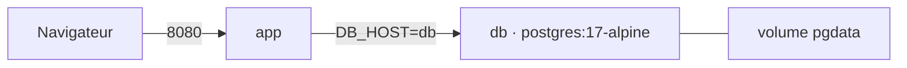

# Fiche — Gestion de tâches

Mariem Younes — https://github.com/mariem115/mini-projet-devops

## Architecture

Le navigateur joint le service `app` sur le port 8080. `app` joint PostgreSQL par le nom `db`, sur le réseau privé de Compose. Le port 5432 n'est pas publié. Les données restent dans le volume `pgdata`.

En local, `compose.yaml` construit l'image `app:1.0`. En environnement de test, `compose.staging.yaml` ne construit rien : il prend `ghcr.io/mariem115/app:${IMAGE_TAG}`.

Adminer ne démarre qu'à la demande : `docker compose --profile debug up -d`, port 8081.



## Version mise en service

`ghcr.io/mariem115/app:v1.0.0`, tag `v1.0.0` sur le commit `1be9793`.

Publication : https://github.com/mariem115/mini-projet-devops/actions/runs/45269159878

`scripts/wait-healthy.sh` a affiché `staging sain` et s'est terminé par 0.

## Retour arrière

1. Publication de `v1.1.0` : https://github.com/mariem115/mini-projet-devops/actions/runs/45271590702
2. Mise en service de cette image, sans construction locale :

```bash
IMAGE_TAG=v1.1.0 docker compose -f compose.staging.yaml pull
IMAGE_TAG=v1.1.0 docker compose -f compose.staging.yaml up -d
./scripts/wait-healthy.sh
```

Le script a affiché `staging non sain` et s'est terminé par 1. Le journal indiquait `Running on http://127.0.0.1:8080`.

3. Retour à l'image déjà publiée, sans `build` :

```bash
IMAGE_TAG=v1.0.0 docker compose -f compose.staging.yaml up -d --no-build
./scripts/wait-healthy.sh
```

Le script a affiché `staging sain` et s'est terminé par 0. Les tags `v1.0.0` et `v1.1.0` n'ont pas été réécrits.

Sous PowerShell, fixer le tag avant Compose : `$env:IMAGE_TAG = "v1.0.0"`.

## Pipelines à présenter

- Réussite : https://github.com/mariem115/mini-projet-devops/actions/runs/44801710836
- Échec : https://github.com/mariem115/mini-projet-devops/actions/runs/45215562233
- Merge request rouge, laissée ouverte : https://github.com/mariem115/mini-projet-devops/pull/3
